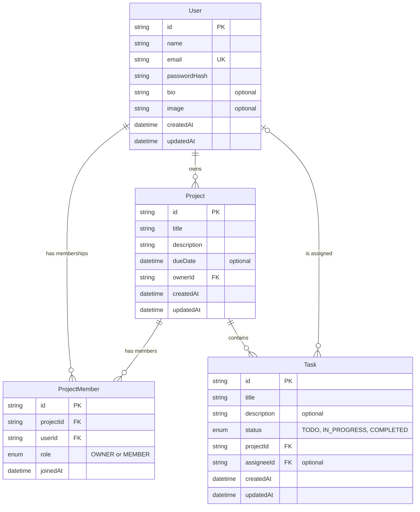

# Data Model

TaskFlow uses PostgreSQL (Neon) with Prisma. The schema lives in `prisma/schema.prisma`. The diagram below shows the four core entities, their key fields and their relationships.

## Relationships

- **User → Project (owner):** one user can own many projects. Each project has exactly one owner.
- **User ↔ Project (members):** many-to-many, resolved by the `ProjectMember` join table, which also stores the member's role (`OWNER` or `MEMBER`). Each (project, user) pair is unique.
- **Project → Task:** one project has many tasks. Deleting a project deletes its tasks (`onDelete: Cascade`).
- **User → Task (assignee):** a task has at most one assignee. Deleting a user leaves their tasks unassigned (`onDelete: SetNull`).

## Enums

- **TaskStatus:** `TODO`, `IN_PROGRESS`, `COMPLETED`
- **ProjectRole:** `OWNER`, `MEMBER`

## Notes

- `passwordHash` stores a hashed password, never plaintext. It would be removed if the team chooses Clerk for authentication.
- Optional fields: `User.bio`, `User.image`, `Project.dueDate`, `Task.description`, `Task.assigneeId`.
- Prisma nullable fields are represented as nullable values (`T | null`), not omitted properties. The shared TypeScript model projections use generated Prisma types; the public `User` projection intentionally excludes `passwordHash`.
- Project membership is represented by `ProjectMember`; `memberIds` is not a scalar field on `Project`.
